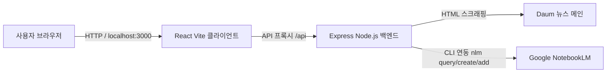

# 📰 Daum 실시간 TOP 5 뉴스 & Google NotebookLM 종합 브리핑 시스템

> **daum.net**의 실시간 주요 TOP 5 뉴스를 스크래핑하여 시각화하고, **Google NotebookLM (`notebooklm-mcp-cli`)**과 연동하여 AI 기반 종합 트렌드 분석 및 노트북 소스 자동 등록을 제공하는 풀스택 웹 애플리케이션입니다.

---

## 📌 목차
1. [핵심 기능](#-핵심-기능)
2. [기술 스택 및 아키텍처](#-기술-스택-및-아키텍처)
3. [프로젝트 구조](#-프로젝트-구조)
4. [사전 요구사항 및 설치](#-사전-요구사항-및-설치)
5. [실행 방법](#-실행-방법)
6. [상세 기능 사용법](#-상세-기능-사용법)
   - [1. 종합 트렌드 요약 (NotebookLM AI)](#1-종합-트렌드-요약-notebooklm-ai)
   - [2. 자동 갱신 시간 설정](#2-자동-갱신-시간-설정-기본-10분)
   - [3. 뉴스 랭킹 뷰 및 원문 이동](#3-뉴스-랭킹-뷰-및-원문-이동)
   - [4. NotebookLM 노트북 등록](#4-notebooklm-노트북-등록)
   - [5. 다크 모드 및 실시간 검색](#5-다크-모드-및-실시간-검색)
7. [백엔드 API 명세](#-백엔드-api-명세)
8. [문제 해결 (FAQ)](#-문제-해결-faq)

---

## ✨ 핵심 기능

- **실시간 Daum 뉴스 수집**: Daum 포털 메인의 '이 시각 주요뉴스'에서 실시간 1위~5위 기사를 자동 크롤링 (제목, 요약, 언론사, 갱신 시간, 썸네일, 링크).
- **최상단 NotebookLM 종합 트렌드 요약**: 5개 뉴스를 종합 분석하여 **1) 상세 분석**, **2) 오늘의 핵심 트렌드 3가지**, **3) 주요 시사점**을 최상단 대시보드에 표시.
- **분 단위 자동 갱신 (기본 10분)**: 1분/3분/5분/10분/15분/30분/60분/꺼짐 중 선택 가능하며, 실시간 초 단위 카운트다운 타이머 제공.
- **NotebookLM 원클릭 연동**:
  - **[NotebookLM 일괄 등록]**: 오늘 TOP 5 뉴스를 묶어 새 노트북을 자동 생성하고 기사 URL 5건 및 요약 노트를 등록.
  - **[단일 기사 등록]**: 특정 뉴스만 개별 노트북 소스로 추가.
  - **[NotebookLM 원문 열기]**: Google NotebookLM 웹 콘솔로 즉시 이동.
- **프리미엄 UI/UX**:
  - 1위 기사는 골드 뱃지의 대형 히어로 카드로 시각적 위계 극대화.
  - 다크 모드 / 라이트 모드 원클릭 토글 (설정 유지).
  - 키워드 및 언론사 실시간 필터링 검색.
  - 기사 URL 원클릭 클립보드 복사 (토스트 알림).

---

## 🛠️ 기술 스택 및 아키텍처



- **Frontend**: React 18, Vite, Lucide React (아이콘), Vanilla CSS (Glassmorphism & Ambient Glow)
- **Backend**: Node.js, Express, Cheerio (HTML 파싱), Axios, Child Process
- **AI / MCP CLI**: `notebooklm-mcp-cli` (`nlm` CLI 도구)

---

## 📂 프로젝트 구조

```text
aniti_mcp_notebook/
├── client/                     # 프론트엔드 (React + Vite)
│   ├── src/
│   │   ├── App.jsx            # 메인 React 컴포넌트
│   │   ├── App.css            # 반응형 글래스모피즘 디자인 스타일시트
│   │   ├── index.css          # 글로벌 디자인 토큰 및 다크/라이트 모드
│   │   └── main.jsx           # React 진입점
│   ├── index.html             # 웹 폰트(Pretendard) 및 메타태그 설정
│   ├── vite.config.js         # 프록시 설정 (port 3000 -> backend 5000)
│   └── package.json
├── server/                     # 백엔드 (Node.js + Express)
│   ├── index.js               # 뉴스 크롤러 및 NotebookLM 연동 REST API
│   └── package.json
├── run-all.js                  # 서버 + 클라이언트 동시 구동 스크립트
├── package.json                # 루트 패키지 설정
└── README.md                   # 시스템 사용 설명서
```

---

## 📦 사전 요구사항 및 설치

### 1. Node.js & uv 설치 확인
- **Node.js**: v18 이상 권장 (v20+ 최적)
- **Python uv**: `uv` 도구가 설치되어 있어야 `notebooklm-mcp-cli`를 사용할 수 있습니다.

### 2. 의존성 패키지 설치
프로젝트 루트 디렉토리에서 다음 명령어를 실행합니다:
```bash
# 전체 의존성 설치 (서버 및 클라이언트)
npm run install:all
```

### 3. Google NotebookLM 최초 로그인 인증
Google 계정 세션을 연결하기 위해 터미널에서 **단 1회** 로그인을 수행합니다:
```bash
nlm login
```
> **참고**: 명령어를 실행하면 Chrome 브라우저가 열립니다. Google 계정으로 로그인하시면 인증 쿠키가 안전하게 저장되어 이후 모든 작업이 자동 처리됩니다.

---

## 🚀 실행 방법

### 방법 1. 원클릭 동시 실행 (권장)
프로젝트 루트 디렉토리에서 아래 명령어를 실행하면 백엔드와 프론트엔드가 동시에 실행됩니다:
```bash
npm run dev
# 또는
node run-all.js
```

### 방법 2. 개별 실행
터미널을 2개 열어 각각 실행할 수도 있습니다:
```bash
# 터미널 1 - 백엔드 서버 (http://localhost:5000)
npm run server

# 터미널 2 - 프론트엔드 (http://localhost:3000)
npm run client
```

### 접속 주소:
- **웹 애플리케이션**: **`http://localhost:3000`**
- **백엔드 API 엔드포인트**: **`http://localhost:5000/api/news/top5`**

---

## 📖 상세 기능 사용법

### 1. 종합 트렌드 요약 (NotebookLM AI)
- 화면 최상단에 위치한 보라색 배너 영역입니다.
- Google NotebookLM이 오늘 수집된 5개 기사를 다각도로 분석하여 핵심 트렌드 3가지와 시사점을 Markdown 형식으로 일목요연하게 제공합니다.
- **[NotebookLM 원문]**: 클릭 시 Google NotebookLM 웹사이트의 실제 분석 노트북으로 바로 연결됩니다.
- **[요약 재분석]**: 최신 기사를 기준으로 AI 분석을 새로 고치고 싶을 때 누릅니다.
- **[접기/펼치기 (▲/▼)]**: 요약 본문을 접어 뉴스 카드를 더 넓게 볼 수 있습니다.

### 2. 자동 갱신 시간 설정 (기본: 10분)
- 상단 헤더 우측의 `⏱️ 타이머` 드롭다운에서 자동 갱신 주기를 설정할 수 있습니다.
- **설정 옵션**: `1분`, `3분`, `5분`, `10분 (기본)`, `15분`, `30분`, `60분`, `자동 갱신 끔`
- **카운트다운 배지**: 다음 갱신까지 남은 시간이 실시간으로 표시되며(`09:59` → `09:58`), 시간이 다 되면 자동으로 뉴스와 트렌드 요약을 갱신합니다.
- 설정값은 브라우저에 저장되므로 재접속 시에도 유지됩니다.

### 3. 뉴스 랭킹 뷰 및 원문 이동
- **TOP 1 히어로 카드**: 오늘 가장 주목받는 1위 뉴스가 대형 썸네일과 본문 요약과 함께 골드 뱃지로 강조됩니다.
- **TOP 2~5 그리드 카드**: 2위부터 5위까지의 기사가 순위 뱃지와 함께 깔끔하게 정렬됩니다.
- **기사 원문 읽기**: 제목 또는 [기사 전문 / 링크 아이콘]을 클릭하면 daum.net 원문 페이지가 새 탭으로 열립니다.
- **링크 복사**: `공유 아이콘(Share)`을 누르면 기사 URL이 클립보드에 복사되고 토스트 알림이 뜹니다.

### 4. NotebookLM 노트북 등록
- **TOP 5 전체 일괄 등록**:
  - 상단 헤더의 **[NotebookLM 일괄 등록]** 버튼을 클릭합니다.
  - `[Daum 뉴스] YYYY-MM-DD 오늘의 TOP 5 뉴스 브리핑`이라는 이름으로 새 노트북이 자동 생성되고, 5개 기사 URL 및 요약 노트가 일괄 등록됩니다.
- **개별 기사 등록**:
  - 1위 카드의 **[NotebookLM 등록]** 버튼 또는 2~5위 카드의 **[NLM]** 버튼을 클릭하면 해당 기사만 NotebookLM에 등록됩니다.

### 5. 다크 모드 및 실시간 검색
- **다크/라이트 모드**: 헤더 우측의 `해/달 아이콘`을 눌러 언제든 눈이 편안한 테마로 변경할 수 있습니다.
- **실시간 검색창**: 뉴스 제목, 언론사명, 요약문 키워드를 입력하면 화면에 즉시 필터링되어 나타납니다.

---

## 📡 백엔드 API 명세

| Method | Endpoint | 설명 |
|---|---|---|
| `GET` | `/api/news/top5` | daum.net 실시간 주요 TOP 5 뉴스 크롤링 결과 조회 |
| `GET` | `/api/notebooklm/trend-summary` | NotebookLM 기반 종합 트렌드 분석 요약 (15분 캐시) |
| `POST` | `/api/notebooklm/trend-summary/refresh` | NotebookLM 트렌드 요약 강제 재실행 |
| `POST` | `/api/notebooklm/register-top5` | TOP 5 뉴스 전체를 새 NotebookLM 노트북에 일괄 등록 |
| `POST` | `/api/notebooklm/register-single` | 개별 뉴스 기사를 NotebookLM에 소스로 등록 |
| `GET` | `/api/notebooklm/status` | NotebookLM 로그인 및 세션 상태 점검 (`nlm doctor`) |
| `GET` | `/api/notebooklm/notebooks` | 사용자의 기존 NotebookLM 노트북 목록 조회 |
| `GET` | `/api/health` | 서버 헬스체크 |

---

## ❓ 문제 해결 (FAQ)

### Q1. "NotebookLM 인증이 만료되었습니다"라는 메시지가 나와요.
- Google 로그인 쿠키 세션이 만료된 경우입니다. 터미널에서 다음 명령어를 실행하여 다시 로그인해 주세요:
  ```bash
  nlm login
  ```
- 만약 Chrome이 이미 실행 중이라는 에러가 발생하면, 모든 Chrome 창을 닫고 다시 실행하시면 정상 작동합니다.

### Q2. 포트 3000번 또는 5000번이 이미 사용 중이라는 오류가 발생합니다.
- 다른 터미널에서 서버가 이미 실행 중인지 확인하고 종료하거나, `server/index.js`의 `PORT` 번호를 변경해 주세요.

### Q3. 뉴스 이미지가 표시되지 않아요.
- 일부 언론사 보안 정책상 외부 이미지 링크가 차단될 경우, 우아한 그라디언트 기본 플레이스홀더 아이콘으로 자동 대체되도록 설계되어 있습니다.
